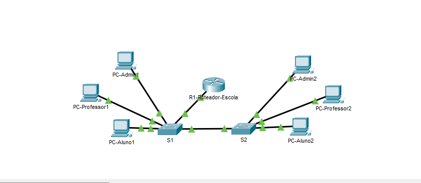

# Laboratório de Redes — VLANs, DHCP e Inter-VLAN Routing

## 1. Sobre o projeto

Este projeto consiste em uma rede escolar simulada no Cisco Packet Tracer, dividida em três setores: Alunos, Professores e Administração.

O laboratório foi desenvolvido para praticar conceitos de redes de computadores, utilizando VLANs, trunks, DHCP e roteamento entre VLANs.

## 2. Objetivos

- Criar VLANs para separar os setores da escola.
- Configurar portas de acesso e enlaces trunk.
- Implementar roteamento entre VLANs.
- Configurar DHCP para distribuir endereços IP automaticamente.
- Testar a comunicação entre computadores.
- Aprender a verificar e solucionar problemas com comandos Cisco IOS.

## 3. Topologia da rede

A rede possui:

- 1 roteador: R1.
- 2 switches: S1 e S2.
- 6 computadores: 2 por setor.

### Conexões

- R1 GigabitEthernet 0/0 ↔ S1 GigabitEthernet 0/2.
- S1 GigabitEthernet 0/1 ↔ S2 GigabitEthernet 0/1.
- Os computadores estão conectados às portas FastEthernet 0/1, 0/2 e 0/3 de cada switch.

## 4. Plano de endereçamento IPv4

| VLAN | Setor | Rede | Gateway |
|---|---|---|---|
| 10 | Alunos | 192.168.10.0/24 | 192.168.10.1 |
| 20 | Professores | 192.168.20.0/24 | 192.168.20.1 |
| 30 | Administração | 192.168.30.0/24 | 192.168.30.1 |

**Máscara de sub-rede:** 255.255.255.0

Os endereços de `.1` a `.20` de cada rede foram excluídos da distribuição DHCP.

## 5. Configuração das VLANs

| VLAN | Nome | Porta no S1 | Porta no S2 |
|---|---|---|---|
| 10 | ALUNOS | Fa0/1 | Fa0/1 |
| 20 | PROFESSORES | Fa0/2 | Fa0/2 |
| 30 | ADMINISTRACAO | Fa0/3 | Fa0/3 |

Os enlaces trunk transportam o tráfego das VLANs 10, 20 e 30 usando o padrão IEEE 802.1Q.

## 6. Roteamento entre VLANs

Foi utilizado o método **Router-on-a-Stick**, com subinterfaces no roteador R1.

| Subinterface | VLAN | Endereço IP |
|---|---|---|
| G0/0.10 | 10 | 192.168.10.1/24 |
| G0/0.20 | 20 | 192.168.20.1/24 |
| G0/0.30 | 30 | 192.168.30.1/24 |

Cada subinterface funciona como gateway da respectiva rede.

## 7. DHCP

O roteador foi configurado com três pools DHCP:

- ALUNOS
- PROFESSORES
- ADMINISTRACAO

Os computadores recebem automaticamente seus endereços IP e as informações de gateway e DNS.

## 8. Testes realizados

- [x] Os seis computadores receberam endereços IP via DHCP.
- [x] Comunicação entre computadores da VLAN 10 testada com ping.
- [x] Comunicação entre VLANs 10 e 20 testada com ping.
- [x] Comunicação entre VLANs 10 e 30 testada com ping.
- [x] Subinterfaces do roteador verificadas com `show ip interface brief`.
- [x] Rotas verificadas com `show ip route`.
- [x] Concessões DHCP verificadas com `show ip dhcp binding`.
- [x] VLANs verificadas com `show vlan brief`.
- [x] Enlaces trunk verificados com `show interfaces trunk`.

## 9. Principais comandos utilizados

**No roteador:**

- `show ip interface brief`
- `show ip route`
- `show ip dhcp pool`
- `show ip dhcp binding`

**Nos switches:**

- `show vlan brief`
- `show interfaces trunk`

## 10. Aprendizados

Durante o desenvolvimento, foram praticados os conceitos de VLAN, portas access, trunk, IEEE 802.1Q, DHCP, subinterfaces, roteamento entre redes e diagnóstico básico de conectividade.

## 11. Melhorias futuras

- Implementar ACLs para controlar a comunicação entre setores.
- Criar uma VLAN específica para servidores.
- Simular falhas e documentar procedimentos de diagnóstico.
- Expandir a topologia com novos dispositivos.

## Autor

Projeto desenvolvido para fins de estudo e prática de redes de computadores utilizando o programa Cisco Packet Tracer.
